<div align="center">


# IPTV

**Xtream Codes tabanlı, Flutter ve mpv ile geliştirilmiş modern IPTV oynatıcı.**

Linux masaüstü · Windows · Android TV / TV Stick · macOS · iOS

[](LICENSE)
[](https://flutter.dev)
[-6D28D9)](https://mpv.io)
[](#kurulum-ve-%C3%A7al%C4%B1%C5%9Ft%C4%B1rma)

</div>

> **Not:** Uygulama hiçbir yayın veya içerik sağlamaz. Kullanıcı kendi Xtream Codes IPTV aboneliğinin bilgileriyle giriş yapar; tüm içerik sorumluluğu kullanıcıya aittir.

---

## Ekran Görüntüleri

Koyu **"Kömür"** teması, **Fraunces + Hanken Grotesk** tipografisi ve hem fare/klavye hem de TV kumandası için tasarlanan arayüz:

| Ana Sayfa | Canlı TV & EPG |
| :---: | :---: |
| 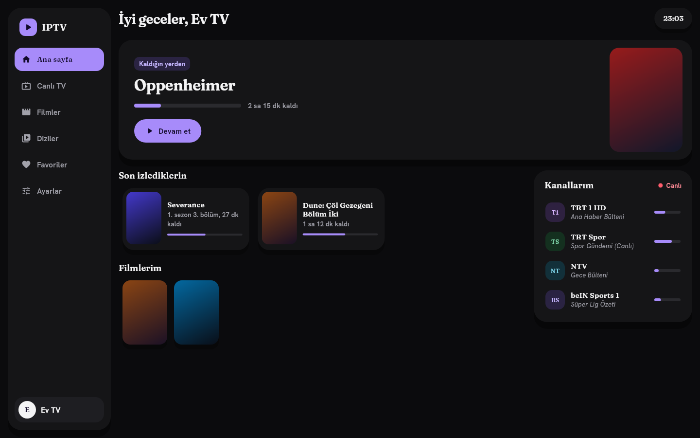 | 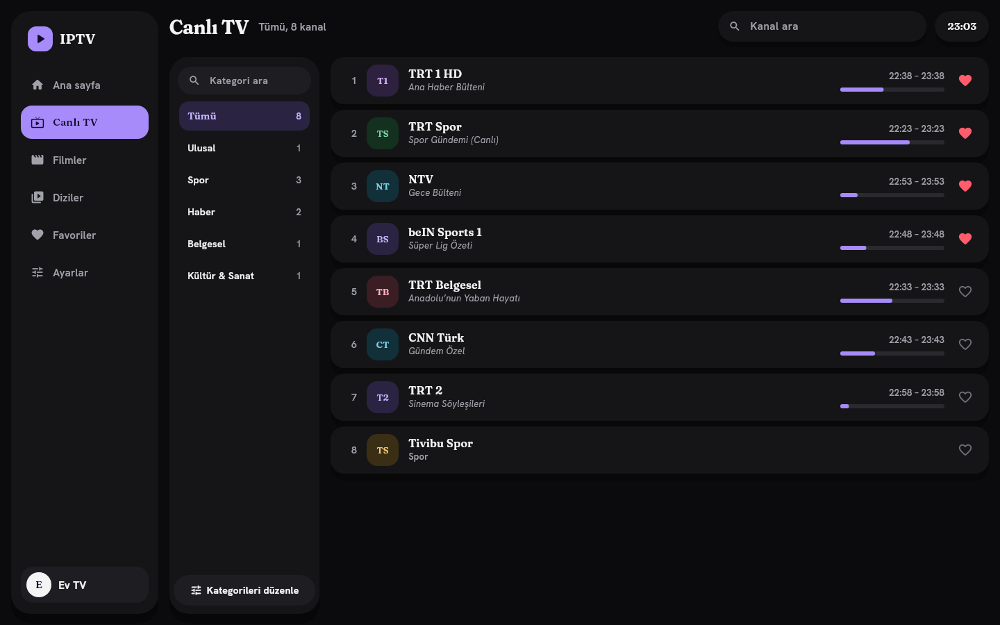 |
| *Kaldığın yerden devam et, son izlediklerin ve favori kanalların* | *Anlık program rehberi (EPG), ilerleme çubuğu ve kanal rozetleri* |

| Filmler & Diziler | Dizi / Film Detayı |
| :---: | :---: |
| 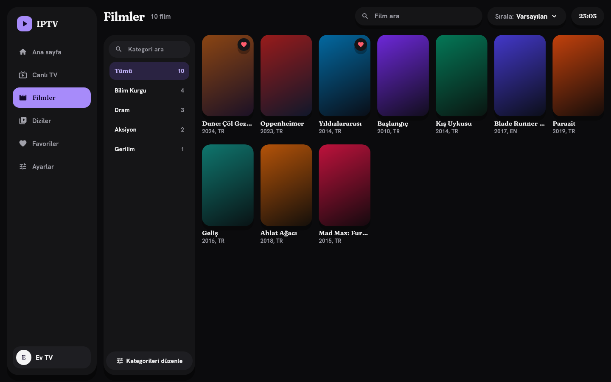 | 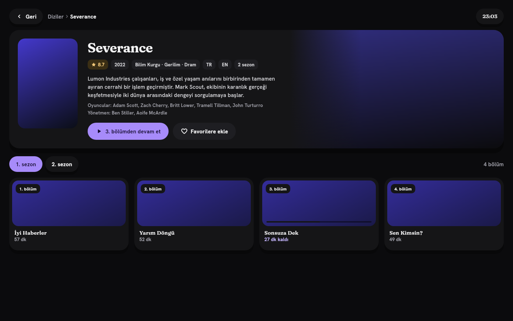 |
| *Temiz başlıklar, yıl/dil rozetleri ve sıralama seçenekleri* | *Sezon seçimi, bölüm kartları ve izleme durumu* |

| Oynatıcı | Ayarlar |
| :---: | :---: |
| 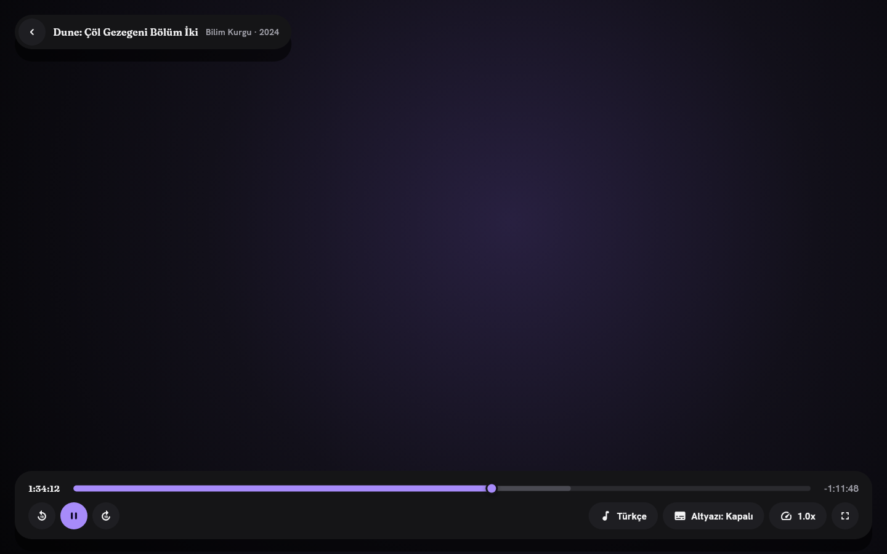 | 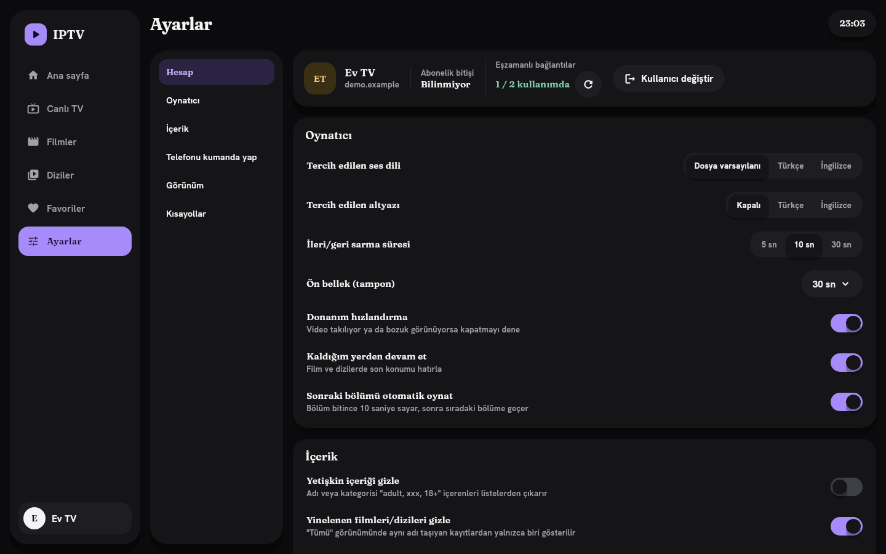 |
| *Yüzen denetim kartı, ses/altyazı parçaları ve hız kontrolü* | *Hesap, oynatıcı, içerik, telefon kumandası ve görünüm ayarları* |

### iPhone  Tasarımı (Dikey & Yatay)

Dynamic Island ve Home Indicator güvenli alanlarına uyumlu, tek elle kullanılan yüzen buzlu cam kapsül çubuğu (dikey), ince yüzen sol ray (yatay) ve hibrit 16:9 / tam ekran OLED oynatıcı:

| Dikey Ana Sayfa | Dikey Canlı TV | Dikey Oynatıcı |
| :---: | :---: | :---: |
| 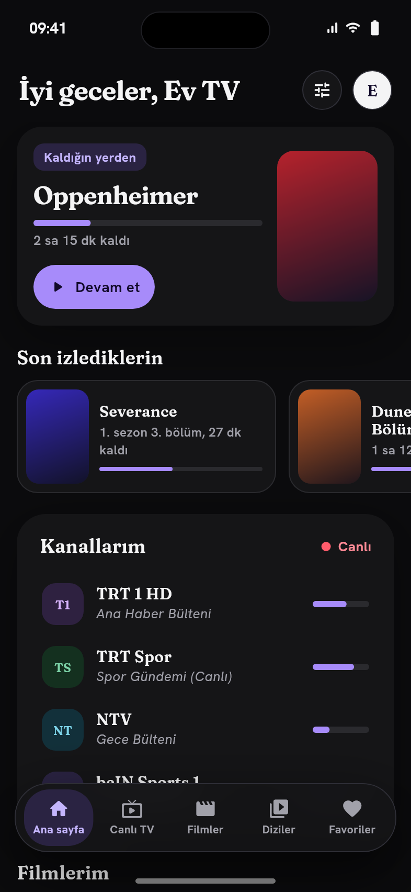 | 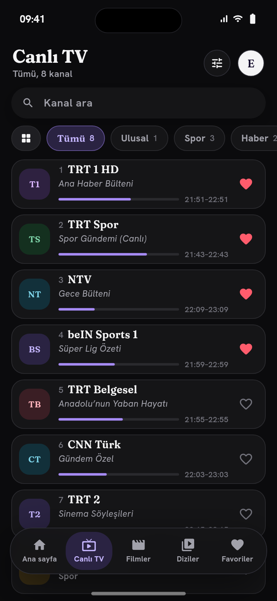 | 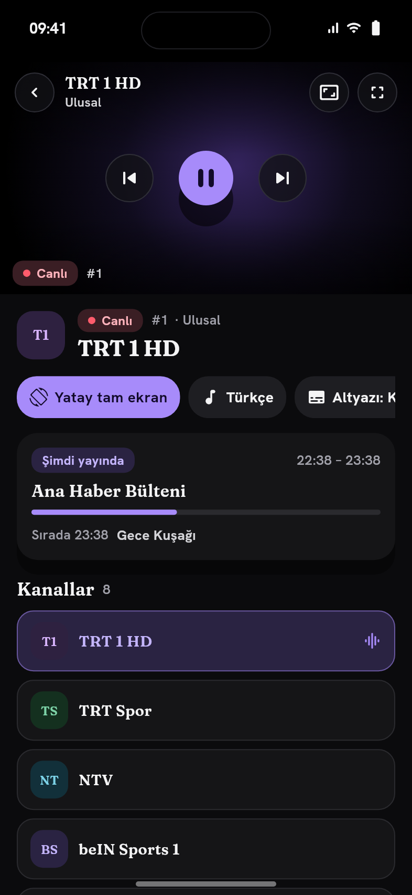 |

| Yatay Ana Sayfa | Yatay Tam Ekran Oynatıcı |
| :---: | :---: |
| 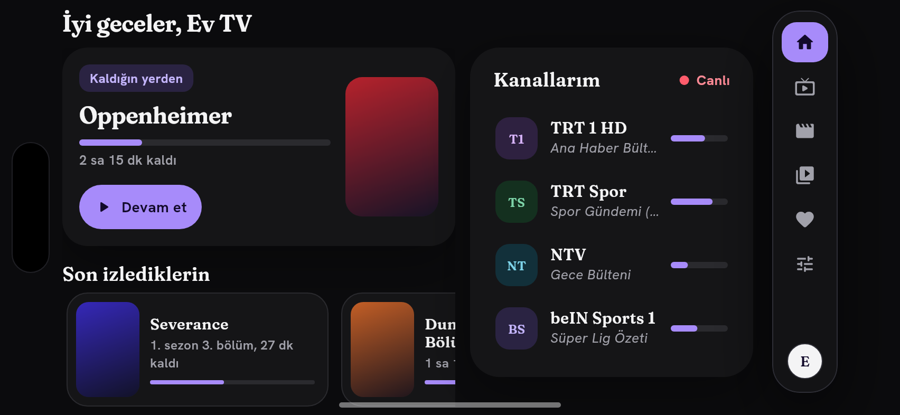 | 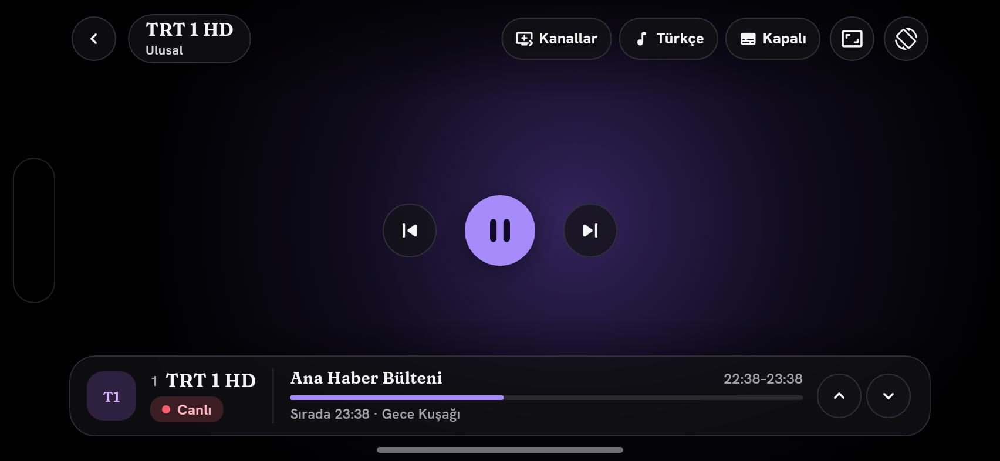 |

İnteraktif tasarım vitrini: `docs/superpowers/specs/iphone15-mockups/index.html` · Tasarım belgesi: `docs/superpowers/specs/2026-11-19-iphone15-arayuz-design.md`

---

## Neden bu oynatıcı?

- **Tam mpv gücü:** Tarayıcı/Chromium tabanlı oynatıcıların aksine filmlerin içindeki **tüm gömülü ses ve altyazı parçalarını** listeler, yaygın tüm video/ses kodeklerini akıcı oynatır.
- **Hem masaüstü hem TV stick:** Linux bilgisayarda fare/klavye ile rahatça kullanılır; **Xiaomi Mi TV Stick (Android 9, 1 GB RAM)** gibi düşük bellekli TV cihazlarında kumanda (D-pad) modu ve bellek optimizasyonlarıyla akıcı çalışır.
- **Telefonu kumanda ve klavye yap:** TV'de kumandayla uzun adres veya arama yazmak yerine ekrandaki **QR kodu** telefonla okutup hem giriş bilgilerini hem de uzaktan kumanda/klavye kontrolünü telefon tarayıcısından yapabilirsin (yalnızca yerel ağda çalışır).

---

## Özellikler

### Giriş ve Çoklu Hesap
- **Profil ekranı & Otomatik giriş:** Kayıtlı hesaplar kartlar halinde listelenir, açılışta son kullanılan hesapla doğrudan giriş yapılır (istenirse tek tıkla iptal edilebilir).
- **Güvenli parola saklama:** Parolalar işletim sistemi anahtarlığında saklanır (`libsecret` / KDE Cüzdan / Android Keystore / Keychain).
- **Telefondan QR ile giriş:** TV kumandasıyla yazmaya gerek kalmadan yerel ağ üzerinden tek kullanımlık adresle giriş.
- **Eşzamanlı bağlantı takibi:** Ayarlar → Hesap bölümünde aktif bağlantı sayısı (`1 / 2 kullanımda`) ve abonelik durumu gösterilir.

### İçerik ve Kütüphane
- **Ana sayfa:** Günün saatine göre selamlama, **Kaldığın yerden** devam kartı, **Son izlediklerin**, favori filmler/diziler ve **Kanallarım** paneli.
- **Canlı TV & EPG:** Kanal numaraları, renkli rozetler, her kanalda anlık program adı, saat aralığı ve ilerleme çubuğu; oynatıcıda şimdiki/sıradaki program bilgisi.
- **Film & Dizi detayı:** Afiş, puan, yıl, süre, tür, özet, oyuncular, yönetmen; dizilerde sezon sekmeleri ve bölüm kartları.
- **Temiz başlıklar:** `"Dune |2024| TR-EN"` gibi ham adları ayıklayarak temiz başlık + `2024` `TR` `EN` rozetleri gösterir; kategori adlarındaki gereksiz sağlayıcı öneklerini temizler.
- **Kategori yönetimi:** Kategorileri gizleme, sürükleyerek veya oklarla sıralama, "en üste al" ve kategori içi arama (canlı, film ve dizi için ayrı sıralama).
- **Filtreleme ve sıralama:** Varsayılan, yeni eklenen, A–Z, yıl sıralaması; yinelenen kayıtları gizleme ve yetişkin içerik filtresi.

### Oynatıcı (`mpv` / `media_kit`)
- **Ses ve altyazı seçimi:** Tüm gömülü ses ve altyazı parçalarını listeleme; varsayılan Türkçe/İngilizce dil tercihi.
- **Hızlanan sarma & Zamana git:** Arka arkaya basışta artan sarma adımları (`10 sn → 30 sn → 1 dk → 5 dk → 10 dk`) ve kumandayla çalışan **"Zamana git"** penceresi.
- **Otomatik sonraki bölüm:** Dizilerde bölüm bittiğinde 10 saniyelik sayaçla otomatik sonraki bölüme geçiş (ayarlardan açılıp kapatılabilir).
- **Akıllı hata yönetimi:** Canlı yayın koptuğunda otomatik yeniden bağlanma; eşzamanlı bağlantı sınırı doluysa net uyarı (`"Bağlantı sınırı dolu (2/2)..."`).

### Arayüz, TV ve Performans
- **Kumanda (TV) modu:** Belirgin odak çerçevesi, D-pad ile gezinme, metin alanlarına **OK ile giriş** (ekran klavyesi odak gelince kendiliğinden açılmaz), hızlı kanal değiştirme (`zapping`).
- **Arayüz ölçeği:** `%50–%140` arası ayarlanabilir ölçek (TV'de varsayılan `%70`).
- **1 GB RAM dostu:** Küçük mpv ön belleği, anahtar kareye hızlı sarma, küçük çözünürlüklü afiş önbelleklemesi ve kumanda modunda gölgesiz liste çizimi.

---

## Kurulum ve Çalıştırma

**Gereksinimler:**
- [Flutter SDK](https://flutter.dev) (stable)
- **Linux:** `clang`, `cmake`, `ninja`, `gtk3` ve **`mpv`** (`libmpv`)
- **Windows:** Visual Studio (C++ ile Masaüstü geliştirme iş yükü; `mpv` otomatik olarak paketlenir)
- **Android:** JDK 17 + Android SDK
- **macOS / iOS:** Xcode + CocoaPods

### Geliştirme ortamında çalıştırma

```bash
flutter pub get
flutter run -d linux
```

### Linux'a kurulum (kullanıcı dizinine, `sudo` gerekmez)

Uygulama menüsüne **IPTV** kısayolunu ve uçbirime `iptv` komutunu ekler:

```bash
flutter build linux --release
./linux/packaging/install.sh
```

### Windows (Visual Studio veya GitHub Actions)

```powershell
flutter pub get
flutter build windows --release
# Çıktı: build\windows\x64\runner\Release\iptv_app.exe
# Kurulum paketi (Inno Setup 6):
iscc windows\packaging\installer.iss
# Çıktı: build\windows\installer\IPTV-Setup.exe
```

Windows bilgisayarın yoksa GitHub **Actions** sekmesindeki **Windows build** iş akışı hem **`IPTV-Setup.exe`** kurulum paketini hem de taşınabilir `iptv-windows-portable.zip` arşivini otomatik olarak derleyip artifact olarak sunar.

### Android TV / TV Stick

Cihazda geliştirici seçenekleri ve USB hata ayıklama açık olmalıdır:

```bash
flutter build apk --release --target-platform android-arm   # 32-bit ARM TV stick'ler için
# veya 64-bit cihazlar için:
# flutter build apk --release --target-platform android-arm64

adb install -r build/app/outputs/flutter-apk/app-release.apk
```

### macOS ve iOS (Xcode / iPhone 15 veya GitHub Actions)

```bash
# macOS
flutter build macos --release
open build/macos/Build/Products/Release/iptv_app.app

# iPhone 15 (Mac + Xcode)
flutter pub get
cd ios && pod install && cd ..
open ios/Runner.xcworkspace
# Xcode'da Runner → Signing & Capabilities → Team seçip iPhone 15'e Run (▶) ile yükle
# veya doğrudan terminalden:
flutter run --release -d <iphone-id>
```

Mac bilgisayarın yoksa GitHub **Actions** sekmesindeki:
- **macOS build** iş akışı imzasız `iptv-macos.zip` paketini,
- **iOS build** iş akışı imzasız `iptv-ios.ipa` paketini

otomatik olarak derleyip artifact olarak sunar.

---

## Klavye ve Kumanda Kısayolları

| Tuş | İşlev |
|---|---|
| `Boşluk` / `OK` | Oynat / Duraklat (veya denetimleri aç) |
| `←` / `→` | Geri / İleri sar (basılı tutunca/tekrar basınca hızlanır) |
| `↑` / `↓` | Canlı TV'de kanal değiştir / Ses |
| `M` | Sessiz / Sesi aç |
| `F` | Tam ekran |
| `Esc` / `Geri` | Denetimleri gizle veya oynatıcıdan çık |

---

## Proje Yapısı

```text
lib/
  main.dart                    Tema, arayüz ölçeği, başlangıç akışı
  src/
    xtream.dart                Xtream Codes API istemcisi (canlı, film, dizi, EPG, detay)
    accounts.dart              Hesap depolama (anahtarlık) ve son kullanılan profil
    login_page.dart            Profil kartları, otomatik giriş, hesap ekleme
    remote_entry.dart          Telefondan QR ile giriş (yerel HTTP sunucu)
    phone_remote.dart          Telefonu kumanda ve klavye yapma sunucusu
    home_page.dart             Ana sayfa, Canlı TV, Filmler, Diziler, Favoriler
    detail_page.dart           Film ve dizi detay sayfası
    player_page.dart           mpv oynatıcı, kumanda modları, hata/yeniden bağlanma
    player_chrome.dart         Yüzen başlık hapı, denetim kartı, zaman çubuğu, EPG bloğu
    settings.dart / settings_page.dart
    library.dart               Favoriler, izleme geçmişi, kaldığın yerden devam
    epg_widgets.dart           Program rehberi önbelleği ve satırları
    title_utils.dart           Başlık ve kategori adı temizleme
    ui/                        "Kömür" tasarım belirteçleri, tema, odak halkası, ortak bileşenler
assets/
  fonts/                       Fraunces & Hanken Grotesk (OFL)
  icon/                        Uygulama simgeleri ve Android TV banner
test/                          Birim ve widget testleri
linux/packaging/               Linux kurulum betiği ve simge
.github/workflows/             Windows, macOS ve iOS otomatik derleme iş akışları
```

---

## Testler ve Analiz

```bash
flutter analyze
flutter test
```

---

## Bilinen Sınırlar

- Yalnızca **Xtream Codes** API desteklenir (doğrudan M3U/M3U8 dosya desteği henüz yok).
- Cihazlar arası **eşitleme yok**: favoriler, izleme geçmişi ve kategori sıralaması her cihazda yerel olarak tutulur.
- İçerik listeleri her açılışta sunucudan çekilir (yerel önbellek henüz yok); çok büyük listeler 1 GB RAM'li TV stick'lerde ilk açılışta birkaç saniye sürebilir.
- Arama, Türkçe karakterleri ayırt eden düz içerme (`contains`) aramasıdır.
- Linux'ta sistemde `mpv` (`libmpv`) kurulu olmalıdır.

## Yol Haritası

1. **Yerel önbellek (SQLite):** Listeleri diske kaydedip uygulamayı anında açmak.
2. **Gelişmiş arama:** Türkçe karakter duyarsız, film/dizi/kanalı birlikte tarayan genel arama.
3. **Favori kanal sıralama:** Favori kanalları kullanıcının kendi sırasıyla dizebilmesi.
4. **Hızlı kanal geçişi:** Canlı TV'de kanal numarası tuşlayarak doğrudan geçiş ve tam günlük EPG görünümü.
5. **Cihazlar arası eşitleme:** Favori ve izleme geçmişi eşitleme.

---

## Lisans

[MIT](LICENSE)
